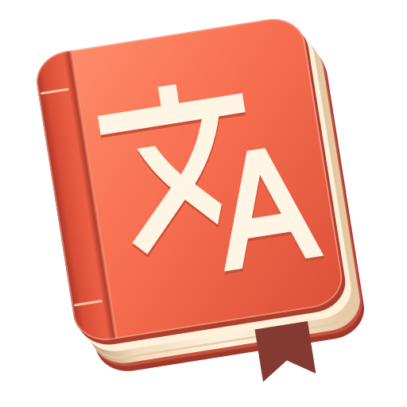

#  AI Translate

基于 **.NET 10 + Avalonia 12** 的跨平台 AI 桌面词典、全局划词、截图原位翻译与 FSRS 科学记忆生词本，支持 **Windows / macOS / Linux**。

## 核心特性

- **AI 认知词典工作台**：支持 DeepSeek、OpenAI、兼容端点与本地 Ollama；提供多词性释义、词源词根拆解、AI 巧记、语法剖析、高频搭配与双语例句。
- **三大取词与翻译通道**：
  - **灵动划词速译 (`Alt + Q`)**：提取选中文字弹窗速译，自动还原系统剪贴板。
  - **XCapture 截图原位翻译 (`Alt + S`)**：离线 RapidOCR 识别 + 表格/段落分析 + 原位背景擦除排版重绘。
  - **剪贴板监听 (`Alt + W`)**：支持后台实时监听或快捷键即刻精翻。
- **神经语音引擎**在软件启动时后台预加载离线模型。支持英美多声线、IPA 音标朗读、自然拼读、慢速跟读和生词卡片连读。
- **FSRS 超级生词本**：完整保留查词原句上下文，内置 FSRS 间隔重复算法（闪卡 / 语境完形填空 / 看义拼写 / 盲听默写），支持导出至 Anki TSV、Markdown、CSV、JSON。

## 项目结构

```text
src/
  AiTranslate.Core/              # 核心领域模型、FSRS 记忆调度算法与跨平台契约
  AiTranslate.Ai/                # AI 流式传输、区域翻译复核与认知词典服务
  AiTranslate.Ocr/               # 本地离线 RapidOCR (ONNX Runtime + SkiaSharp)
  AiTranslate.Speech/            # KokoroSharp 神经网络 TTS 与自然拼读拆解引擎
  AiTranslate.Vocabulary/        # 生词本持久化、多维检索与多格式导入导出
  AiTranslate.Platform.Windows/  # Windows 截图、全局热键、剪贴板与划词捕获
  AiTranslate.Platform.MacOS/    # macOS 屏幕捕获、pbpaste 监听与 AppleScript 划词
  AiTranslate.Platform.Linux/    # Linux (X11/Wayland) 截图与 Primary Selection 划词
  AiTranslate.Desktop/           # Avalonia Bento UI 工作台、系统托盘与截图覆盖层
tests/
  AiTranslate.Tests/             # 核心算法、FSRS 调度、翻译管线与语音拼读测试
```

## 开发与构建

### 环境要求
- [.NET 10 SDK](https://dotnet.microsoft.com/) (`10.0.100` 或更高版本)
- 支持操作系统：Windows 10/11、macOS 12+、Linux (X11 / Wayland)

### 常用命令

```bash
# 1. 还原依赖并编译全解决方案
dotnet build AiTranslate.sln

# 2. 启动桌面客户端
dotnet run --project src/AiTranslate.Desktop/AiTranslate.Desktop.csproj

# 3. 运行自动化测试套件
dotnet test tests/AiTranslate.Tests/AiTranslate.Tests.csproj

# 4. 发布跨平台可执行程序 (以 Windows / macOS / Linux 为例)
dotnet publish src/AiTranslate.Desktop/AiTranslate.Desktop.csproj -c Release -r win-x64
dotnet publish src/AiTranslate.Desktop/AiTranslate.Desktop.csproj -c Release -r osx-arm64
dotnet publish src/AiTranslate.Desktop/AiTranslate.Desktop.csproj -c Release -r linux-x64
```

### 桌面图标与发布

Windows 可执行文件内嵌多尺寸图标。macOS 发布目录中的 `AI Translate.app` 可整体移入「应用程序」，Finder 和 Dock 使用包内的 ICNS，菜单栏使用跟随系统明暗的模板图标。

Linux 发布目录包含应用菜单条目和 hicolor 图标。在 Linux 上将发布目录放到固定位置后，可以在该目录执行以下命令，为当前用户注册桌面入口。`~/.local/bin` 需要在桌面会话的 `PATH` 中。

```sh
data_home="${XDG_DATA_HOME:-$HOME/.local/share}"
mkdir -p "$HOME/.local/bin" "$data_home/applications" "$data_home/icons"
ln -sfn "$PWD/AiTranslate.Desktop" "$HOME/.local/bin/AiTranslate.Desktop"
install -m 644 share/applications/ai-translate.desktop "$data_home/applications/"
cp -R share/icons/hicolor "$data_home/icons/"
```

品牌母版和分平台资源位于 [Assets/Brand](src/AiTranslate.Desktop/Assets/Brand)。修改 SVG 后，可用安装了 `resvg-py` 和 `Pillow` 的 Python 运行 `python tools/generate-icons.py`，重建 ICO、ICNS、PNG 和 symbolic SVG。

## 缓存、术语参考与离线模型

工作台默认使用「自动 · 中英互译」。提交中文时译为英语，提交英文时译为简体中文。也可以在输入框下方固定目标语言，划词和剪贴板快译共用这一选择。中英混排按正文判断，日语纯汉字和很短的混排文本可手动指定。截图原位翻译保留独立的语言选择。

单词结果把双语例句放在对应的句型或搭配下面。读长句时，将鼠标移到原文的语法高亮上可看解释。点击带下划线的表达，或选中原文、译文、例句中的文字并右键查词，可以带着所在句查询。联查页的「返回上一级」会恢复之前的结果与滚动位置。

有些表达两种说法都成立，意思却不同。「用法对照」会并列说明两种说法各在什么场景使用，例如 `stop doing` 和 `stop to do`。「词形变化」列出过去式、复数等形式，「词族」列出可以继续点查的派生词。句段结果中的「译法与依据」引用原文和主译文中的实际片段，遇到歧义时说明另一种译法成立的条件。

「补查常用义与短语」会把当前词条交给 AI 再检查一次，按需追加有例句的义项、固定表达或用法对照。已列出的句型或搭配缺双语例句时，工作台会显示「补全例句」和具体处数。两种补查都由用户点选触发，保留已有译文。遇到值得记的例句，可点句旁的「自测」，回想被遮住的实际词形，再揭晓原句和译文。

每次查词、划词、剪贴板翻译和段落翻译都会将完整结果自动保存到本机用户数据目录的 `AiTranslate/dictionary-cache.sqlite3`。相同原文、目标语、上下文与术语参考会直接读取本地结果，重启后也可离线使用。截图翻译在同一数据库按目标语和有序 OCR 区域文字保存译文，再次遇到相同内容时可直接原位排版。

「重新用 AI 翻译」和截图的「重新识别并翻译」会跳过已有译文，成功后覆盖对应记录。失败或取消会保留之前的成功结果。「补全例句」和「补查常用义与短语」会把新增内容写回对应词条。

翻译服务可读取当前原文命中的词本术语、短语和习语，最多八条，只将这些词的原文与译法随同本次请求发送给所选模型。界面列出实际提供的术语参考。

构建时会准备并校验固定版本的 Kokoro ONNX 权重。离线构建可将 v0.2.0 的 `kokoro.onnx` 放在仓库根目录，或指定 `-p:KokoroModelPath=<绝对路径>`。发布时请分发整个 publish 目录，其中包含 `KokoroModels/`、`voices/`、`espeak/` 和 `OcrModels/`。语音和 OCR 在本地运行，首次使用无需下载权重。首次 AI 翻译使用配置的供应商或本地 Ollama。

## 默认快捷键

| 快捷键 | 功能说明 |
| :--- | :--- |
| `Alt + D` | 呼出 / 激活主词典工作台 |
| `Alt + Q` | 全局划词即时翻译弹窗 |
| `Alt + S` | 启动 XCapture 截图原位翻译 |
| `Alt + W` | 读取并翻译当前剪贴板文本 |

